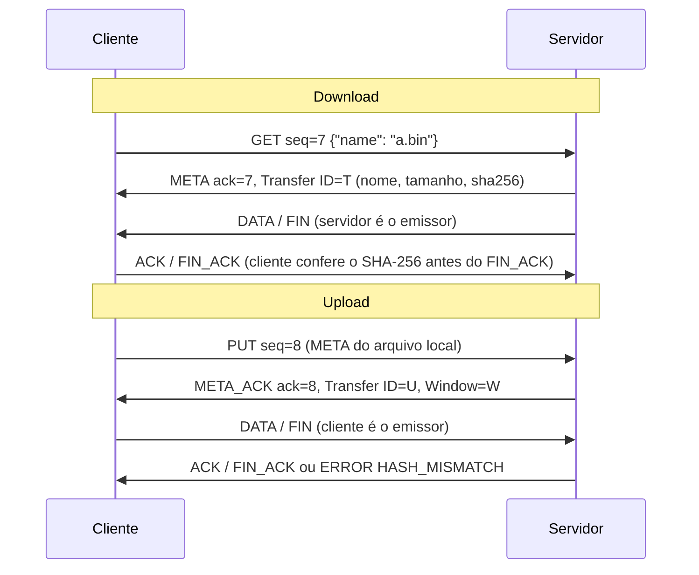

# Sigma Protocol — especificação do formato (versão 1)

Este documento define o cabeçalho e as mensagens de transporte do Sigma
Protocol. É a referência para `internal/wire` (codec) e `internal/transport`
(confiabilidade). Decisões complementares a `plano-de-implementacao.md` e
`passos.md` estão marcadas como **[complemento]**.

## 1. Convenções

- Cada mensagem ocupa exatamente um datagrama UDP.
- Inteiros são unsigned em **network byte order (big-endian)**.
- Datagrama de aplicação limitado a **1.200 bytes**: cabeçalho fixo de
  **44 bytes** + payload de **0 a 1.156 bytes**. O limite reduz a chance de
  fragmentação IP em redes usuais (MTU 1.500), mas não a elimina em caminhos
  com MTU menor; essa limitação deve constar no relatório.
- "Bloco" é um trecho de até 1.156 bytes do arquivo transferido.

## 2. Cabeçalho

```text
 0                   1                   2                   3
 0 1 2 3 4 5 6 7 8 9 0 1 2 3 4 5 6 7 8 9 0 1 2 3 4 5 6 7 8 9 0 1
+-+-+-+-+-+-+-+-+-+-+-+-+-+-+-+-+-+-+-+-+-+-+-+-+-+-+-+-+-+-+-+-+
|                        Magic ("SGMA")                         |  0
+-+-+-+-+-+-+-+-+-+-+-+-+-+-+-+-+-+-+-+-+-+-+-+-+-+-+-+-+-+-+-+-+
|    Version    |     Type      |             Flags             |  4
+-+-+-+-+-+-+-+-+-+-+-+-+-+-+-+-+-+-+-+-+-+-+-+-+-+-+-+-+-+-+-+-+
|                                                               |  8
+                          Session ID                           +
|                                                               |
+-+-+-+-+-+-+-+-+-+-+-+-+-+-+-+-+-+-+-+-+-+-+-+-+-+-+-+-+-+-+-+-+
|                                                               | 16
+                          Transfer ID                          +
|                                                               |
+-+-+-+-+-+-+-+-+-+-+-+-+-+-+-+-+-+-+-+-+-+-+-+-+-+-+-+-+-+-+-+-+
|                           Sequence                            | 24
+-+-+-+-+-+-+-+-+-+-+-+-+-+-+-+-+-+-+-+-+-+-+-+-+-+-+-+-+-+-+-+-+
|                              ACK                              | 28
+-+-+-+-+-+-+-+-+-+-+-+-+-+-+-+-+-+-+-+-+-+-+-+-+-+-+-+-+-+-+-+-+
|                        Receive Window                         | 32
+-+-+-+-+-+-+-+-+-+-+-+-+-+-+-+-+-+-+-+-+-+-+-+-+-+-+-+-+-+-+-+-+
|        Payload Length         |         Header Length         | 36
+-+-+-+-+-+-+-+-+-+-+-+-+-+-+-+-+-+-+-+-+-+-+-+-+-+-+-+-+-+-+-+-+
|                       Checksum (CRC32C)                       | 40
+-+-+-+-+-+-+-+-+-+-+-+-+-+-+-+-+-+-+-+-+-+-+-+-+-+-+-+-+-+-+-+-+
|                     Payload (0..1156 bytes)                  ...
+-+-+-+-+-+-+-+-+-+-+-+-+-+-+-+-+-+-+-+-+-+-+-+-+-+-+-+-+-+-+-+-+
```

| Offset | Bytes | Campo          | Tipo Go   | Semântica                                                                                    |
| ------ | ----- | -------------- | --------- | -------------------------------------------------------------------------------------------- |
| 0      | 4     | Magic          | `uint32`  | Constante `0x53474D41` (ASCII `SGMA`). Identifica datagramas do protocolo                    |
| 4      | 1     | Version        | `uint8`   | `1` nesta especificação                                                                      |
| 5      | 1     | Type           | `MsgType` | Tipo da mensagem (seção 3)                                                                   |
| 6      | 2     | Flags          | `uint16`  | Reservado. Deve ser `0` na versão 1; diferente de zero é rejeitado                           |
| 8      | 8     | Session ID     | `uint64`  | Identificador aleatório da sessão (etapa 2: atribuído na autenticação)                       |
| 16     | 8     | Transfer ID    | `uint64`  | Identificador da transferência; `0` fora de uma transferência                                |
| 24     | 4     | Sequence       | `uint32`  | Índice do bloco (DATA) ou valor definido por tipo (seção 4)                                  |
| 28     | 4     | ACK            | `uint32`  | Sequence confirmado, conforme o tipo (seção 4)                                               |
| 32     | 4     | Receive Window | `uint32`  | Blocos que o remetente desta mensagem ainda aceita a partir da sua base receptora (`rcvBase`) |
| 36     | 2     | Payload Length | `uint16`  | Tamanho exato do payload em bytes (0..1.156)                                                 |
| 38     | 2     | Header Length  | `uint16`  | `44` na versão 1                                                                             |
| 40     | 4     | Checksum       | `uint32`  | CRC32C (Castagnoli) do cabeçalho, com este campo zerado, seguido do payload                  |

Correspondência com os exemplos do enunciado (seção 4 do `tp-rc2.pdf`):
número de sequência → Sequence; ACK → ACK; tipo da mensagem → Type; tamanho
do pacote → Payload Length + Header Length; checksum → Checksum; janela
anunciada → Receive Window.

**Por que CRC32C?** O checksum de 16 bits do UDP é fraco e pode estar
desativado em IPv4. O CRC32C detecta todos os erros de 1 bit e todas as
rajadas de até 32 bits, e o Go o calcula com instruções de hardware
(`hash/crc32`, tabela Castagnoli). Ele detecta corrupção acidental, não
adulteração intencional; o arquivo completo é verificado por SHA-256.

## 3. Tipos de mensagem

**[complemento]** Códigos agrupados por função (o primeiro dígito
hexadecimal indica o grupo), para facilitar a leitura de capturas. O valor `0`
é inválido. `META_ACK` foi acrescentado à lista do plano para que a
confirmação de META não compartilhe o espaço de numeração dos ACKs de dados.

| Código | Nome        | Grupo          | Etapa |
| ------ | ----------- | -------------- | ----- |
| `0x01` | HELLO       | autenticação   | 2     |
| `0x02` | CHALLENGE   | autenticação   | 2     |
| `0x03` | AUTH        | autenticação   | 2     |
| `0x04` | AUTH_OK     | autenticação   | 2     |
| `0x10` | LIST        | operações      | 2     |
| `0x11` | LIST_RESULT | operações      | 2     |
| `0x12` | GET         | operações      | 2     |
| `0x13` | PUT         | operações      | 2     |
| `0x20` | META        | transferência  | 1     |
| `0x21` | META_ACK    | transferência  | 1     |
| `0x22` | DATA        | transferência  | 1     |
| `0x23` | ACK         | transferência  | 1     |
| `0x24` | FIN         | transferência  | 1     |
| `0x25` | FIN_ACK     | transferência  | 1     |
| `0x30` | ERROR       | diversos       | 1     |
| `0x31` | PING        | diversos       | 4     |
| `0x32` | PONG        | diversos       | 4     |

A semântica dos tipos das etapas 2 e 4 (autenticação, operações e
PING/PONG) está na seção 9.

## 4. Mensagens de transferência (etapa 1)

Em todas: Session ID e Transfer ID identificam a transferência; campos não
citados valem `0` e são ignorados pelo receptor. A "direção" é sempre
**emissor** (quem tem o arquivo) → **receptor** (quem grava o arquivo); no
download o emissor é o servidor e no upload é o cliente.

| Tipo     | Direção            | Sequence                    | ACK                         | Receive Window                     | Payload                          |
| -------- | ------------------ | --------------------------- | --------------------------- | ---------------------------------- | -------------------------------- |
| META     | emissor → receptor | `0`                         | —                           | —                                  | JSON com metadados (abaixo)      |
| META_ACK | receptor → emissor | —                           | `0`                         | janela inicial do receptor (`W`)   | vazio                            |
| DATA     | emissor → receptor | índice do bloco             | —                           | —                                  | bytes do bloco                   |
| ACK      | receptor → emissor | —                           | índice do bloco confirmado  | espaço livre no buffer do receptor | vazio                            |
| FIN      | emissor → receptor | total de blocos `N`         | —                           | —                                  | vazio                            |
| FIN_ACK  | receptor → emissor | —                           | `N` (ecoa o FIN)            | —                                  | vazio                            |
| ERROR    | qualquer           | —                           | Sequence da mensagem que causou o erro, se houver | —                | JSON com código e mensagem       |

**Payload de META** (JSON, máximo 1.156 bytes; nome com até 255 bytes UTF-8):

```json
{"name": "teste.bin", "size": 83886080, "block_size": 1156,
 "sha256": "<64 dígitos hexadecimais>"}
```

**Payload de ERROR**:

```json
{"code": "HASH_MISMATCH", "message": "hash recebido difere do original"}
```

Códigos iniciais: `HASH_MISMATCH`, `TIMEOUT`, `BAD_REQUEST`, `NOT_FOUND`,
`NO_SPACE`, `INTERNAL`. Novos códigos podem ser acrescentados sem mudar a versão.

### Sequence e blocos

- Sequence de DATA é o índice do bloco a partir de `0`. O bloco `i` contém os
  bytes `[i·1156, min((i+1)·1156, tamanho))` do arquivo; todos os blocos têm
  1.156 bytes, exceto possivelmente o último.
- Número de blocos: `N = ceil(tamanho / 1156)`. Arquivo vazio tem `N = 0` e vai
  direto de META_ACK para FIN.
- Tamanho máximo de arquivo: `(2^32 − 1) · 1156` bytes (≈ 4,6 TiB). Assim o
  Sequence nunca dá a volta (*wrap-around*) dentro de uma transferência.

### Janela

- O receptor mantém `rcvBase` (próximo bloco que falta para escrever em ordem)
  e um buffer de no máximo `W` blocos.
- Receive Window em ACK e META_ACK = blocos que o receptor ainda aceita a partir
  de `rcvBase` (`W − blocos no buffer`).
- O emissor nunca tem mais que `min(janela local, última janela anunciada)`
  blocos não confirmados. Com janela anunciada `0`, envia periodicamente um
  único bloco como sonda.

## 5. Validação na recepção

Aplicada nesta ordem; a primeira falha descarta o datagrama sem alterar estado.
O erro é contado nas métricas e, nesta etapa, nunca gera resposta (o timeout
do emissor cuida da recuperação).

| # | Verificação                                                    | Erro em `internal/wire` |
| - | -------------------------------------------------------------- | ----------------------- |
| 1 | Datagrama com pelo menos 44 bytes                              | `ErrShort`              |
| 2 | Magic = `0x53474D41`                                           | `ErrBadMagic`           |
| 3 | Version = `1`                                                  | `ErrVersion`            |
| 4 | Header Length = `44`                                           | `ErrLength`             |
| 5 | Payload Length ≤ 1.156 e igual a `tamanho do datagrama − 44`   | `ErrLength`             |
| 6 | CRC32C confere                                                 | `ErrChecksum`           |
| 7 | Flags = `0`                                                    | `ErrFlags`              |
| 8 | Type conhecido                                                 | `ErrType`               |
| 9 | Session ID e Transfer ID pertencem a uma transferência ativa   | `internal/transport`    |

Os passos 1–8 são feitos por `wire.Decode`; o passo 9, pela camada de
transporte. Flags e Type são verificados após o CRC para que um bit corrompido
nesses campos seja reportado como erro de checksum.

## 6. Vetor de teste

DATA com Session ID `0x0102030405060708`, Transfer ID `0x1112131415161718`,
Sequence `42`, Receive Window `32` e payload `"sigma"` (49 bytes no total):

```text
53 47 4d 41  01  22  00 00                Magic "SGMA", Version 1, Type DATA, Flags 0
01 02 03 04 05 06 07 08                   Session ID
11 12 13 14 15 16 17 18                   Transfer ID
00 00 00 2a                               Sequence = 42
00 00 00 00                               ACK = 0
00 00 00 20                               Receive Window = 32
00 05  00 2c                              Payload Length = 5, Header Length = 44
dc c6 f1 d7                               CRC32C
73 69 67 6d 61                            "sigma"
```

O mesmo vetor está em `internal/wire/header_test.go` (`TestGoldenVector`).
No Wireshark, os bytes acima aparecem logo após os 8 bytes do cabeçalho UDP.

## 7. Exemplo: transferência com perdas

Janela `W = 4`, arquivo de 5 blocos. DATA 2 se perde; depois o ACK do bloco 4
se perde. Só os blocos afetados são retransmitidos (Selective Repeat).

```mermaid
sequenceDiagram
    participant E as Emissor
    participant R as Receptor
    E->>R: META (nome, tamanho, sha256)
    R->>E: META_ACK (Window=4)
    E->>R: DATA seq=0
    E->>R: DATA seq=1
    E-xR: DATA seq=2 (perdido)
    E->>R: DATA seq=3
    R->>E: ACK 0 (Window=4)
    Note over R: escreve 0, rcvBase=1
    R->>E: ACK 1 (Window=4)
    Note over R: escreve 1, rcvBase=2
    R->>E: ACK 3 (Window=3)
    Note over R: 3 fica no buffer
    Note over E: base avança para 2; envia 4
    E->>R: DATA seq=4
    R--xE: ACK 4 (perdido)
    Note over E: RTO do bloco 2 expira
    E->>R: DATA seq=2 (retransmissão)
    R->>E: ACK 2 (Window=4)
    Note over R: escreve 2, 3, 4; rcvBase=5
    Note over E: RTO do bloco 4 expira
    E->>R: DATA seq=4 (retransmissão)
    R->>E: ACK 4 (duplicata: só reconfirma)
    E->>R: FIN seq=5
    Note over R: SHA-256 confere; renomeia o temporário
    R->>E: FIN_ACK ack=5
```

## 8. Limitações conhecidas

- Sem confidencialidade nem autenticação de mensagens: o CRC32C não impede
  adulteração intencional (ver extensão de criptografia no plano).
- Controle de fluxo (janela anunciada) não é controle de congestionamento.
- O limite de 1.200 bytes não garante ausência de fragmentação em todos os
  caminhos.

## 9. Mensagens de controle (etapas 2 e 4)

Implementação: `internal/proto` (payloads), `internal/auth`,
`internal/control` (retransmissão), `internal/server` e `internal/client`.
Explicação do fluxo completo em `docs/aplicacao.md`.

### 9.1 Requisição e resposta

Toda mensagem de controle enviada pelo cliente é uma **requisição**; o
servidor responde com exatamente uma **resposta** (ou ERROR).

- A requisição leva um número em **Sequence**, crescente dentro da sessão
  (1, 2, 3, ...). A resposta ecoa esse número em **ACK**.
- O cliente retransmite a requisição se a resposta não chegar: timeout
  inicial de 500 ms, dobrando até 4 s, no máximo 6 envios (≈ 15 s). Depois
  disso, erro "servidor não responde".
- **Idempotência:** o servidor guarda, por sessão, o Sequence e a resposta da
  última requisição. Requisição repetida (mesmo Sequence) recebe a mesma
  resposta sem ser reexecutada — um GET retransmitido não inicia uma segunda
  transferência. Sequence menor que o último é ignorado (atrasado).
- Datagramas de uma sessão vindos de outro endereço IP/porta são ignorados.
- Payloads são JSON (UTF-8, ≤ 1.156 bytes, sem escape de `<`, `>` e `&`).

| Requisição (cliente) | Session ID | Payload | Resposta (servidor) | Payload da resposta |
| -------------------- | ---------- | ------- | ------------------- | ------------------- |
| HELLO | `0` | vazio | CHALLENGE (Session ID novo) | `{"nonce": "<64 hex>"}` |
| AUTH | sessão | `{"mac": "<64 hex>"}` | AUTH_OK | vazio |
| LIST | sessão | `{"offset": 0}` | LIST_RESULT | `{"files": [{"name": "a.bin", "size": 123}], "next": -1}` |
| GET | sessão | `{"name": "a.bin"}` | META (Transfer ID novo) | JSON de META (seção 4) |
| PUT | sessão | JSON de META (seção 4) | META_ACK (Transfer ID novo, Receive Window) | vazio |
| PING | `0` | `{"nonce": "<32 hex>"}` | PONG | o mesmo payload do PING |

Qualquer requisição pode ser respondida com ERROR (`ACK` = Sequence da
requisição), cujo payload está na seção 4.

### 9.2 Autenticação (HELLO → CHALLENGE → AUTH → AUTH_OK)

1. Cliente envia HELLO com Session ID `0`.
2. Servidor sorteia um **Session ID** (64 bits, `crypto/rand`, não nulo) e um
   **nonce** de 32 bytes, e responde CHALLENGE já com o novo Session ID.
3. Cliente calcula
   `mac = HMAC-SHA256(chave = SHA-256(senha), mensagem = SessionID (8 bytes big-endian) || nonce)`
   e envia AUTH.
4. Servidor recalcula e compara com `hmac.Equal` (tempo constante):
   igual → AUTH_OK e a sessão fica autenticada; diferente → ERROR
   `AUTH_FAILED` e o nonce é descartado (a sessão não pode mais ser
   autenticada; o cliente recomeça com HELLO).

A senha nunca trafega. O nonce é de uso único, então uma resposta capturada
não serve para outra sessão. LIST, GET e PUT em sessão não autenticada,
inexistente ou expirada (2 min sem tráfego) → ERROR `NOT_AUTHENTICATED`.

### 9.3 LIST paginado

`offset` é o índice do primeiro arquivo pedido. O servidor coloca na página
o máximo de entradas que couber em 1.156 bytes; `next` é o `offset` da
próxima página ou `-1` na última. Só arquivos regulares do diretório
compartilhado aparecem (sem subdiretórios, links simbólicos, ocultos ou
temporários), ordenados por nome.

### 9.4 Download (GET) e upload (PUT)

META e META_ACK fazem parte da negociação de controle; o transporte
(seção 4) começa no primeiro DATA.



- **GET:** o servidor responde META e logo em seguida começa a enviar DATA.
  Se o META se perder, o cliente retransmite o GET e recebe o mesmo META
  (idempotência); os DATA que chegaram antes são descartados pelo cliente e
  recuperados pela retransmissão do emissor.
- **PUT:** o servidor valida o META (nome, tamanho), recusa nome existente
  (`EXISTS`) e responde META_ACK; a partir daí é o receptor. Se o META_ACK
  se perder, o cliente retransmite o PUT e recebe o mesmo META_ACK.
- O receptor grava em arquivo temporário e só publica o arquivo (rename)
  depois de conferir que o SHA-256 recebido é igual ao do META. Divergência →
  ERROR `HASH_MISMATCH` no lugar do FIN_ACK, e o temporário é apagado.
- Depois do fim de um upload, o servidor ainda responde FIN repetido com a
  resposta final (FIN_ACK ou ERROR) por 10 s.

### 9.5 PING/PONG (mini-CDN)

PING não exige sessão nem autenticação. O PONG repete Sequence (em ACK) e o
nonce; o cliente só aceita PONG do endereço para o qual enviou o PING, com o
Sequence e o nonce corretos. O RTT é medido no relógio monotônico do
cliente. Algoritmo de escolha em `docs/aplicacao.md`.

### 9.6 Códigos de ERROR

| Código | Quando |
| ------ | ------ |
| `AUTH_FAILED` | senha incorreta |
| `NOT_AUTHENTICATED` | sessão inexistente, expirada ou não autenticada |
| `BAD_REQUEST` | payload malformado, nome inválido (`..`, `/`, ponto inicial, ...) |
| `NOT_FOUND` | arquivo inexistente |
| `EXISTS` | PUT de um nome que já existe |
| `TOO_LARGE` | arquivo acima de `(2^32 − 1) · 1156` bytes |
| `HASH_MISMATCH` | SHA-256 recebido difere do original |
| `NO_SPACE` | disco cheio no receptor |
| `BUSY` | limite de sessões (64) ou de transferências simultâneas (16) |
| `TIMEOUT`, `INTERNAL` | par parou de responder / falha inesperada |
